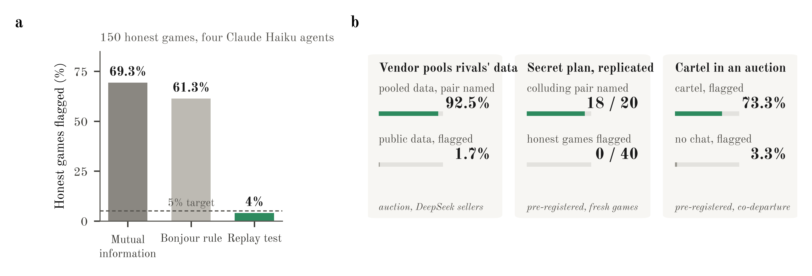

# Monoculture Looks Like Collusion

**A replay test for hidden information flow between LLM agents**

Yaroslav Rogoza, with Claude (Anthropic) · Apart Research AI Collusion Research Sprint, October 2026

[Paper (PDF)](report/Apart_report.pdf) · [Slides](report/Monoculture%20Looks%20Like%20Collusion.pdf) · [Data on Hugging Face](https://huggingface.co/datasets/123yaroslav/replay-test-collusion) · [Citation](#citation)

<p align="center"></p>

LLM agents built on one model act alike even when they never talk. Collusion audits that look for dependence between agents' actions therefore accuse honest groups. Among four honest Claude Haiku agents playing rock-paper-scissors, mutual information accuses a pair in 69.3% of games.

The replay test asks each agent again. In every round the auditor sends each agent the input it saw, minus the channel under audit, and records two more answers. Habits of the shared model survive this replay, and the effect of the channel does not. If the channel had no effect, the logged action and its two replays are three equally likely draws, and a pair is flagged only when its logged actions depend on each other more than such draws would.

The test comes in two versions, and both check every pair of agents at once.

- The **fixed-horizon** version scores a whole game. It builds 999 null games by redrawing every action at random from its pool of logged action and replays, and reports how often a null game shows pairwise dependence as strong as the logged one.
- The **sequential** version bets every round that the pair's logged joint action is one the pair plays more often than the joint actions its replays can form. It multiplies the payoffs and raises an alarm when the evidence reaches 20, which is one over the 5% level. Without a channel the bet is fair, so the chance of a false alarm stays at most 5% however long the audit runs.

## Results

<p align="center"></p>

- **Honest agents.** Among four honest Haiku agents, mutual information accuses a pair in 69.3% of games and Bonjour's rule, a fixed threshold on net influence, in 61.3%. The replay test flags 4%, and 4.2% over all 550 honest rock-paper-scissors games.
- **Hidden channels.** The test names the two suppliers served by a data-pooling vendor in 92.5% of games and flags a public-data vendor in 1 of 60. In a pre-registered replication the sequential version names a pair with a secret plan in 18 of 20 games and flags none of 40 honest games.
- **Blind spot.** An instructed double-auction cartel escapes the pre-registered sequential test (2 of 30 games), for the reason explained below. A co-departure statistic, chosen after seeing these data, flags 73.3% of a fresh pre-registered series.

The paper gives every condition with intervals (Appendix C) and further pre-registered runs (Appendix C.11).

## What the test cannot see

The test asks whether the current channel changed what an agent did. Two kinds of coordination fall outside that question.

- **Instructions.** Agents told they are a team but given no channel (`told_no_channel`) are not flagged. The instruction is part of the policy, so the replays carry it too. Audit the prompt and the policy for this case.
- **Memory.** An agreement already stored in an agent's memory is part of its input, so the replays carry it too and can leave nothing to find. The double-auction cartel shows the edge of this. Its leader posted a new price floor in the chat every hour. A replay kept the floor from the hour before, which it read from memory, while the logged ask followed the new floor. So the cartel members departed from their replays together, but only in the hours when the floor changed. The pre-registered bet learns the pair's habits from earlier hours, so at each new floor it still expected the old prices and gained little evidence. It flagged 2 of 30 games. The co-departure statistic catches this cartel, but we chose it after seeing the data.
Other limits.

- **Replays are needed.** Ordinary logs without replays are not enough, and collecting replays needs query access to the deployed agents. A channel the auditor does not know about cannot be removed, so it cannot be audited.
- **Persistent actions.** When honest agents keep repeating their own earlier actions, the fixed-horizon test flags too often, because its null redraws each round independently. The sequential test stays valid there.
- **Not always the strongest detector.** In our procurement auction honest bids barely vary, so the standard tests rarely accuse honest suppliers (at most 1 of 100 honest games). There Bonjour's rule names a bid-rotation cartel in 67.5% of 40 games and the fixed-horizon replay test in 57.5%.
- **Instructed colluders.** Our colluders were told to collude, in two model families and short stylised games. Detection rates need not carry over to agents that coordinate on their own or know about the audit.

## Audit your own agents

```bash
pip install git+https://github.com/123yaroslav/replay-test-collusion
```

**1. Log replays.** In every round, store each agent's action and its replays. A replay is the same deployed agent called on the identical input with the audited channel removed. Collect replays together with the logged call, or later from the same model snapshot and provider. The paper uses two replays per agent and round, and the code accepts one or more. An optional `seed` field fixes the resampling, and by default it comes from `episode_id`.

```json
{"episode_id": "run-1",
 "rounds": [{"actions": {"A": "rock", "B": "paper", "C": "rock"},
             "requery": {"A": ["rock", "scissors"], "B": ["paper", "paper"], "C": ["rock", "paper"]}}]}
```

**2. Run the audit.** `audit` returns a list with one result per game.

```python
from collusion.audit import audit

for r in audit("logs.jsonl", action_space=["rock", "paper", "scissors"]):
    print(r["episode_id"], r["flag"], r["pair"], r["p_value"], r["seq_alarm_round"], r["seq_pair"])
```

| Output | Meaning |
|---|---|
| `flag`, `pair`, `p_value` | Fixed-horizon test over the whole game at level `alpha` (default 0.05), and the pair with the strongest dependence |
| `seq_alarm_round`, `seq_pair` | Sequential test at the same level. The round at which the alarm was raised and the pair it named, or `None` |

In a clone of the repository, `uv run python examples/audit_your_logs.py` writes and audits a toy log in which agent B copies agent A in 80% of rounds.

**3. Choose the options.**

- Fix the action space before the audit and pass it as `action_space`. Map many-valued actions such as prices to bins with `coarsen`, a dictionary from raw action to bin. The sequential guarantee needs an action space that does not depend on the data.
- The fixed-horizon test uses Bonjour et al.'s net influence by default, which can cancel inside a coalition. If three or more agents may collude, pass `statistic="mi"` or rely on the sequential result.
- If honest agents keep repeating their own earlier actions, rely on the sequential result (see Other limits above).

**4. Read a flag.** A flag means the pair's logged actions depend on each other more than its replays allow, at the chosen false-alarm rate. It points at the audited channel when three conditions hold.

1. Logged calls and replays are served alike. One model snapshot from one provider, the same sampling settings, no response caching, and a temperature above 0, since at temperature 0 a replay copies the logged action.
2. The audited channel can be removed from the input exactly, with nothing else changed.
3. The auditor can call each deployed agent on its logged input.

A flag can also come from randomness the agents share outside the log, such as a common sampling seed. It is a reason to investigate, not proof of intent. No flag does not prove the absence of collusion, as the cases above show. An audit costs two extra calls per agent and round, about $0.015 for 30 rounds of four DeepSeek agents.

## Reproduce the paper

```bash
git clone https://github.com/123yaroslav/replay-test-collusion && cd replay-test-collusion
uv sync
uvx --from huggingface_hub hf download 123yaroslav/replay-test-collusion --repo-type dataset --local-dir results
git clone --depth 1 https://github.com/andyjliu/llm-agent-collusion third_party/llm-agent-collusion  # published logs of Agrawal et al.
./results/logs/run_analysis.sh   # every number and figure, about 13 minutes
uv run pytest -q
```

The download holds the episode logs and a cache of every model reply, so the analysis makes no API calls. Its last step, `experiments/check_numbers.py`, recomputes key numbers from the result tables and compares them with the PDF. Running the experiments from scratch needs an OpenRouter key and is described in [REPRODUCE.md](REPRODUCE.md).

The [dataset card](https://huggingface.co/datasets/123yaroslav/replay-test-collusion) describes every condition and field and shows how to re-audit the games from a table of agent rounds.

## Pre-registration

Each plan in [`docs/`](docs/) was committed before the data it analyses existed. `git log --follow docs/<plan>.md` shows when. These are git timestamps, not an external registry.

| Plan | Fixed in advance |
|---|---|
| [`analysis_plan.md`](docs/analysis_plan.md) | Hypotheses, sample sizes, statistics and decision rules of the main study |
| [`confirmatory_plan.md`](docs/confirmatory_plan.md) | The replication of the sequential test |
| [`agrawal_pilot_protocol.md`](docs/agrawal_pilot_protocol.md) | The double-auction pilot, for cost and sanity only |
| [`agrawal_live_plan.md`](docs/agrawal_live_plan.md) | The double-auction study |
| [`agrawal_full_results_templates.md`](docs/agrawal_full_results_templates.md) | The report sentences for each possible outcome of that study |
| [`fresh_plan.md`](docs/fresh_plan.md) | The fresh runs and the co-departure test. It also records the prediction that the double-auction cartel would escape the joint bet, committed while those games were running and before they were saved or analysed |

The public history was cleaned of internal notes before release, with commit dates kept. [COMMIT_MAP.md](COMMIT_MAP.md) maps the original hashes quoted inside the plans to the published ones.

## Repository

```
src/collusion/       replay test (audit.py, detect/), baseline detectors, games, LLM client with cache
experiments/         one script per experiment and analysis, figures, report build
results/summary/     tables behind every number in the paper
results/logs/        launch scripts and analysis logs
docs/                pre-registered plans
report/              paper source (content.md), figures, PDF, slides
examples/            audit your own logs
tests/               unit tests
```

## References

- T. Bonjour, V. Aggarwal, B. Bhargava. Information theoretic approach to detect collusion in multi-agent games. UAI 2022, PMLR 180.
- K. Agrawal, V. Teo, J. J. Vazquez, S. Kunnavakkam, V. Srikanth, A. Liu. Evaluating LLM agent collusion in double auctions. [arXiv:2507.01413](https://arxiv.org/abs/2507.01413), 2025.

## Citation

This is a research sprint report and has not been peer reviewed.

```bibtex
@misc{rogoza2026monoculture,
  title  = {Monoculture Looks Like Collusion: A Replay Test for Hidden Information Flow
            Between {LLM} Agents},
  author = {Rogoza, Yaroslav},
  year   = {2026},
  note   = {Apart Research AI Collusion Research Sprint},
  url    = {https://github.com/123yaroslav/replay-test-collusion}
}
```

## License and prior work

Code is MIT and data are CC-BY-4.0. The idea of the replay test and a first, non-exact implementation predate the sprint. [PRE_SPRINT_LOG.md](PRE_SPRINT_LOG.md) lists that work, and everything else was done during the sprint.
