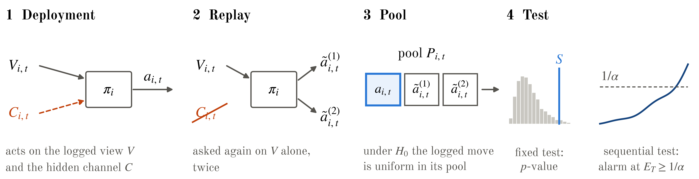

# Monoculture Looks Like Collusion

**A replay test for hidden information flow between LLM agents**

Yaroslav Rogoza · Apart Research AI Collusion Research Sprint, October 2026

[Paper (PDF)](report/Apart_report.pdf) · [Data](https://huggingface.co/datasets/123yaroslav/replay-test-collusion)

<p align="center"></p>

Agents built on one base model share priors, so their actions are correlated even when they never
communicate. Collusion tests that flag pairs whose actions depend on each other therefore accuse
honest agents. The replay test removes this confound. The auditor asks each agent again on its
logged observation with the suspected channel removed, and flags a pair only if the pair's logged
actions depend on each other more than its replays do.

## Results

- **False accusations.** Mutual information flags 69% of games among four honest Claude Haiku
  agents. The replay test flags 4.2% of 550 honest LLM games at a 5% level.
- **Detection.** In a procurement auction between LLM suppliers, it names the pair in 92.5% of 40
  games where a pricing vendor pools two clients' confidential costs, and flags 1.7% of games where
  the vendor uses public data only.
- **Sequential version.** In a pre-registered replication, an anytime-valid variant named an
  instructed pair in 18 of 20 fresh games, against 11 of 20 for the fixed-length test.
- **Target environment.** In a pre-registered re-implementation of Agrawal et al.'s LLM double
  auction (5 conditions x 30 games), the sequential test raised 0 false alarms in 60 no-chat games,
  while time-shuffle mutual information accused 26 of 30 honest no-chat games. An instructed cartel
  raised prices but escaped the pre-registered bet (2 of 30), as predicted before the data: the
  agreement lives in the sellers' memory, which replays keep. A statistic chosen afterwards, agents
  departing together from their own replays, flags 20 of 30 cartel games against 1 of 30, and a
  fresh pre-registered series confirmed it (22 of 30 against 1 of 30).
- **Fresh pre-registered runs.** A likelihood-ratio bet (the growth-optimal one) flags 10 of 40
  DeepSeek secret-plan games where the pre-registered bet flags 0, with 3 of 80 false alarms and the
  provider pinned; a pair hiding its move in a code word inside a public chat is flagged in 12 of 40
  games against 2 of 40 honest small-talk games; a Haiku pair told how the audit works could not
  evade it; Claude Haiku sellers decline a vendor's pooled-data scheme in 99% of rounds, and the
  test still finds the residual effect (6 of 40 against 0 of 40).
- **Scope.** The test detects information that reaches an agent through the audited channel.
  Coordination written into shared instructions, or already stored in an agent's memory, is
  outside its null hypothesis.

## Audit your own agents

In every round, log each agent's action and k ≥ 1 replays: the same deployed policy queried on the
identical observation with the audited channel removed.

```json
{"episode_id": "run-1",
 "rounds": [{"actions": {"A": "rock", "B": "paper", "C": "rock"},
             "requery": {"A": ["rock", "scissors"], "B": ["paper", "paper"], "C": ["rock", "paper"]}}]}
```

```python
from collusion.audit import audit

for r in audit("logs.jsonl", action_space=["rock", "paper", "scissors"]):
    print(r["episode_id"], r["flag"], r["pair"], r["p_value"], r["seq_alarm_round"])
```

Fix the action space before the audit and pass it as `action_space` (bin many-valued actions such
as prices with `coarsen`). The sequential test's guarantee requires an alphabet that does not
depend on the data.

| Output | Meaning |
|---|---|
| `flag`, `pair`, `p_value` | Fixed-length test over the episode, level `alpha` (default 0.05). |
| `seq_alarm_round`, `seq_pair` | Sequential test: the round at which it stopped and the pair it named, or `None`. |

The fixed-length test uses net influence by default, which can cancel inside a coalition. When a
coalition of three or more agents is possible, or actions persist from round to round, use the
sequential result: it keeps its level under feedback, provided replays are served like the
original calls. A flag means the pair's actions carry information that its replays lack. It is a
reason to investigate, not proof of intent.

`uv run python examples/audit_your_logs.py` audits a toy log with a planted pair.

## Reproduce the paper

```bash
uv sync
huggingface-cli download 123yaroslav/replay-test-collusion --repo-type dataset --local-dir results
git clone --depth 1 https://github.com/andyjliu/llm-agent-collusion third_party/llm-agent-collusion
./results/logs/run_analysis.sh   # every number and figure; about 13 min
uv run pytest -q
```

The download includes the cache of every model reply, so the analysis makes no API calls. Running
the LLM experiments from scratch needs an OpenRouter key; see [REPRODUCE.md](REPRODUCE.md).
The analysis plans in [`docs/`](docs/) were committed before the data they analyse were collected.

## Repository

```
src/collusion/     replay test, baseline detectors, games, LLM client
experiments/       one script per experiment
results/summary/   outputs behind every number in the paper
docs/              pre-registered analysis plans
report/            paper source, figures and PDF
examples/          audit your own logs
```

## Citation

```bibtex
@misc{rogoza2026monoculture,
  title  = {Monoculture Looks Like Collusion: A Replay Test for Hidden Information Flow
            Between {LLM} Agents},
  author = {Rogoza, Yaroslav},
  year   = {2026},
  note   = {Apart Research AI Collusion Research Sprint},
  url    = {https://github.com/123yaroslav/replay-test-collusion}
}
```

## License

Code: MIT. Data: CC-BY-4.0. Code written before the sprint is listed in
[PRE_SPRINT_LOG.md](PRE_SPRINT_LOG.md).
